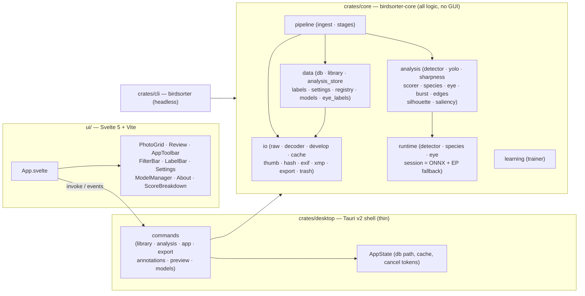
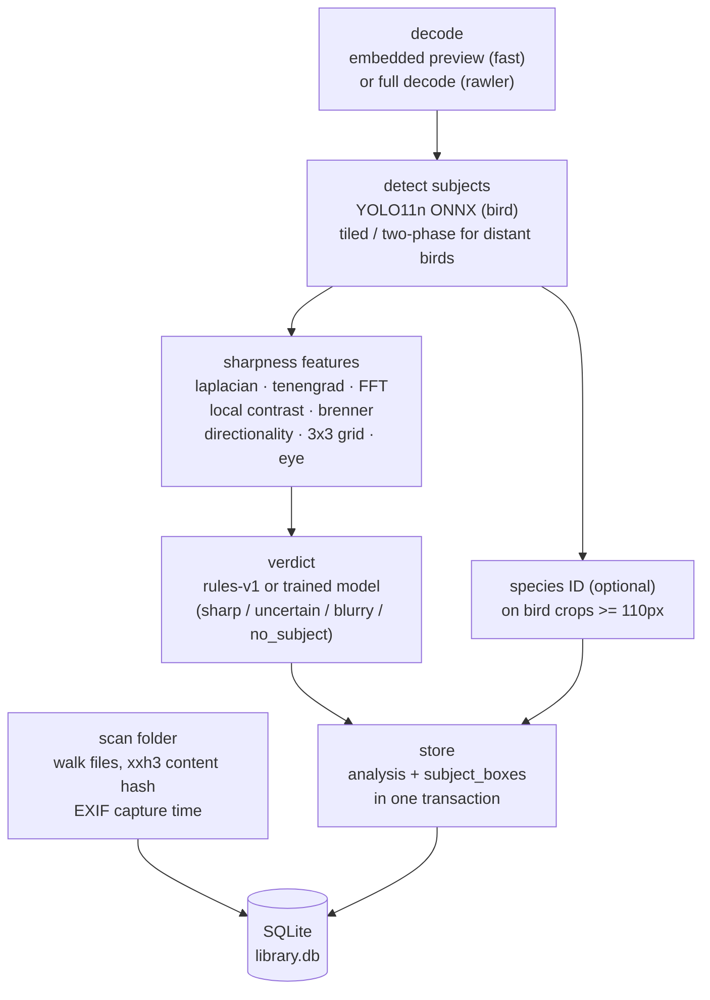

# BirdSorter architecture

A bird-photography RAW culling app for **Windows and macOS**, built as a
**Tauri v2** shell over a headless Rust core with a **Svelte 5** UI.

Two ideas drive the shape of the code:

1. **All logic lives in `birdsorter-core`**, which has no GUI/runtime coupling.
   The pipeline is headless and unit-testable; the desktop shell is thin glue.
2. **CPU-first.** Both installer flavours are self-contained: the default build
   ships the detector (~11 MB), and the model-bundled flavour also ships the
   iNaturalist 2021 species model (~820 MB). Neither needs a CUDA/driver
   install; inference runs on CPU and accelerates when a GPU execution provider
   is available.

---

## 1. System overview



The dependency direction is one-way and enforced by convention (see
`rule.md` §2): `ui → Tauri commands → core`, and `cli → core`. Core never
imports Tauri, browser, or UI types.

---

## 2. The pipeline (RAW → verdict → store)



Key properties:

- **Thumbnails** decode the camera's compact `PRVW`/`THMB` JPEG when present
  (CR3: ~1620×1080, read from the first 2 MiB); analysis and the review's
  fast/full modes still decode the larger track at their requested size.
- **Content identity is the file hash**, not the path, so a moved/renamed RAW
  keeps its analysis; a *changed* file is marked pending again
  (`analysis.analyzed_content_hash`).
- **User data is separate from model output** — labels, ratings, species
  overrides, manual boxes, burst winners and eye annotations survive
  re-analysis. Schema version: **v14** (`subject_boxes` is a normalized table).
- **Per-file writes are atomic** (one transaction per analysis row). A crash
  mid-batch loses at most the in-flight files; it never corrupts the library.
- The **subject** is chosen deliberately: a user-drawn box wins, otherwise the
  sharpest detection; the verdict is based on that subject, not the whole frame
  (so a sharp bird against creamy bokeh is kept).

---

## 3. Crate & module map

```
raw-sorter-app/
├── crates/core/            birdsorter-core — headless, fully unit-tested
│   └── src/
│       ├── analysis/       detector, yolo (pre/post + NMS), sharpness,
│       │                   scorer, species, eye, burst, edges, silhouette,
│       │                   saliency, mod
│       ├── io/             raw (rawler), decoder, develop (demosaic),
│       │                   cache (thumb/preview), thumb, hash (xxh3),
│       │                   exif, xmp (rating sidecar), export, trash, disk
│       │                   (free-space checks)
│       ├── data/           db (schema + migrations), library (scan/re-link),
│       │                   analysis_store, labels, settings, registry
│       │                   (model downloads), models, eye_labels, paths
│       │                   (portable mode), diagnostics (opt-in report)
│       ├── pipeline/       ingest (orchestration, batching, cancel),
│       │                   stages (select_subject, classify_species,
│       │                   subject_first, resolve_detections)
│       ├── learning/       trainer (in-app logistic regression)
│       └── runtime/        detector, species, eye + session (ONNX Runtime
│                           wrapper with the one-shot GPU→CPU fallback)
├── crates/cli/             birdsorter — headless CLI (hash, analyze, list,
│                           bursts, export, export-eyelabels, train,
│                           cleancache, diagnostics, thumb, preview, probe,
│                           genimage, selftest). CI smoke-tester and power-user
│                           tool.
├── crates/desktop/         Thin Tauri v2 adapter
│   └── src/
│       ├── main.rs         module list + startup::run()
│       ├── startup.rs      model seeding, panic hook, tracing, Tauri builder
│       ├── state.rs        AppState (db path, cache, cancel tokens)
│       ├── library.rs      folders, scan, query, trash, ratings
│       ├── analysis.rs     ingest pipeline, review detail, bursts, boxes, train
│       ├── app.rs          settings, species list, About, cache maintenance
│       ├── export.rs       keeper / single-file export
│       ├── annotations.rs  species override, labels/undo, eye points
│       ├── preview.rs      thumbnail / preview rendering (cached data URLs)
│       ├── models.rs       model manager (status/download/import/remove)
│       ├── config.rs       rendering constants
│       └── util.rs         err / open / blocking helpers
├── ui/                     Svelte 5 + TypeScript + Vite
│   └── src/
│       ├── App.svelte      library state + orchestration (~990 lines)
│       └── lib/            PhotoGrid, Review, AppToolbar, FilterBar,
│                           LabelBar, Settings, ModelManager, About,
│                           ScoreBreakdown, api.ts (+ *.test.ts via vitest)
└── tools/                  dev-only Python: ONNX export/quantise/distil,
                            packaging, name enrichment
```

---

## 4. Runtime & compute tiers

One inference engine (`ort`, i.e. ONNX Runtime) serves the detector, species
and eye models. `runtime::session::OnnxSession` is the single wrapper that
owns the session, the input name, and the **provider-fallback policy**:

```
try the configured provider (Auto/GPU)
  └─ runtime failure → rebuild the session on CPU ONCE → retry
       └─ CPU failure → typed error (never a silent "no subject")
```

Capability degrades in tiers: **T0** works with no model
at all (embedded previews + classical sharpness + saliency/silhouette
detectors); **T1** adds the bundled YOLO11n detector; **T2** adds the optional
species classifier and eye model; **T3** uses a GPU execution provider
(DirectML on Windows, CoreML on macOS) when one is usable.

---

## 5. Desktop IPC

The UI talks to Rust only through Tauri commands and events. All image
transport is **data URLs returned from a disk cache keyed by content hash**
(`thumbnail`, `preview_image`) — images never cross IPC per pixel. Render keys
carry a cache version (`{hash}@v2@{dim}`) and are sharded by the first two hash
characters, so a decoder or adjustment change invalidates old bytes and a large
cache never sits in one directory. The cache prunes the oldest entries to a 4 GiB
budget. The review prefetches the previous/next preview, and the grid evicts
off-screen thumbnails above 600 entries.

- **Commands** (request/response): `list_folders`, `add_folder`, `scan_folder`,
  `cancel_scan`, `query_files`, `thumbnail`, `preview_image`, `preview_adjusted`,
  `export_edited`, `analysis_detail`,
  `score_breakdown`, `bursts`, `set_burst_winner`, `set_species`, `label_files`,
  `undo_labels`, `eye_points`, `add_eye_point`, `clear_eye_points`,
  `eye_label_stats`, `trash_files`, `analyze_folder`, `cancel_analysis`,
  `set_subject_box`, `remove_subject`, `identify_subject`, `get_settings`,
  `set_settings`, `get_detection_settings`, `set_detection_settings`,
  `get_preview_settings`, `set_preview_settings`, `get_edits`, `save_edits`,
  `clear_edits`, `species_labels`, `rate_files`, `auto_rate`, `reset_ratings`,
  `app_info`,
  `clean_cache`, `save_diagnostics`, `take_open_request`, `rescore`,
  `export_keepers`, `export_file`, `train`, `models_status`, `download_model`,
  `import_model`, `remove_model`.
- **Events** (core → UI, throttled): `scan-progress`, `scan-done`,
  `scan-error`, `analysis-progress`, `analysis-done`, `analysis-error`.
- Anything that touches disk or CPU runs on a blocking worker
  (`spawn_blocking`), never on the IPC thread.
- Read-only commands (thumbnail, preview, detail, file queries, eye points,
  saved-edit reads) connect to the startup-migrated database without re-running
  the DDL; writes still ensure the schema.

---

## 6. Storage locations

Paths come from the platform user directories (`directories` crate), under a
`BirdSorter` root:

| What | Where (Windows) |
|---|---|
| Library DB | `%APPDATA%\BirdSorter\data\library.db` (SQLite, WAL) |
| Settings | `%APPDATA%\BirdSorter\config\*.json` |
| Preview settings | `%APPDATA%\BirdSorter\config\preview_settings.json` (mode, preload, first-run) |
| Saved preview edits | `library.db`, `edits` table (per file; survives re-analysis) |
| Models | `%APPDATA%\BirdSorter\data\models\` (`BIRDSORTER_MODEL_DIR` overrides) |
| Thumbnail/preview cache | `%LOCALAPPDATA%\BirdSorter\cache\thumbs\` |
| Panic log | `%APPDATA%\BirdSorter\data\crash.log` |

The thumbnail cache is **shared and keyed by content hash**, stored in
two-character shard directories under `thumbs/` — it is not tied to a database.
See `TROUBLESHOOTING.md` before pruning it.

**Portable mode** (`data::paths`): a `portable.flag` file next to the executable
redirects all of the above to `<exe dir>/BirdSorterData/` (DB at the root,
`config/`, `cache/`, `models/`); `BIRDSORTER_DATA_DIR` forces a portable root
without the flag. Absent either, nothing changes.

---

## 7. Performance budgets

Targets for CPU-only hardware (8-core i5-1240P / M1 class), with a GPU execution
provider as the comparison. Current measurements are in `implemented.md`.

| Metric | CPU-only | With a GPU EP |
|---|---|---|
| RAW decode (analysis resolution) | 200–500 ms, parallel ×cores | same (CPU-bound) |
| YOLO11n @640, batch 8 | 80–200 ms/img | 15–50 ms/img |
| Species ID @384 crop (iNat21 ConvNeXt-L) | ~350 ms/crop; can be disabled | same |
| Sharpness feature vector | 30–100 ms/img | same |
| **Sustained ingest** (no species) | **≥ 4 img/s** | ≥ 10 img/s |
| Cold start → usable UI | **< 1.5 s** | — |
| Peak RAM during ingest | ≤ 1.5 GB without species | ≤ 2 GB |
| Install size (no models) | **≤ 80 MB** | — |

---

## 8. Where to go next

- Shipped work (features, change log, measurements): [`implemented.md`](./implemented.md)
- Current status and backlog: [`progress.md`](./progress.md) · [`SUGGESTIONS.md`](./SUGGESTIONS.md)
- Engineering rules (invariants, error handling, DB/model/UI rules): [`rule.md`](./rule.md)
- Model contracts and provenance: [`MODELS.md`](./MODELS.md) · [`EYE_MODEL.md`](./EYE_MODEL.md)
- Building, running and packaging: [`README.md`](../README.md) · [`SIGNING.md`](./SIGNING.md) · [`MACOS_TODO.md`](./MACOS_TODO.md)
- Adding code / debugging: [`CONTRIBUTING.md`](./CONTRIBUTING.md) · [`TROUBLESHOOTING.md`](./TROUBLESHOOTING.md)
