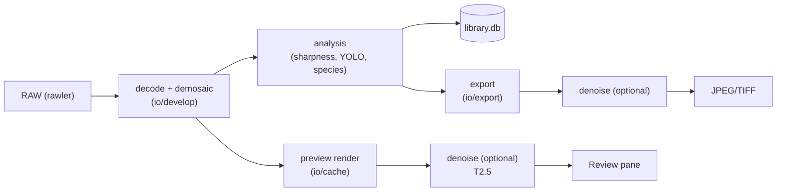

# Denoise plan (future feature)

**Status:** **partially shipped (2026-10-23).** The preview toggle with a
strength blend, the tiled engine, the ONNX runtime wrapper, the registry entry
and `birdsorter denoise` are implemented. Export-time denoise, the SCUNet
"better" bundle, deblur and the CFA/linear-light work below are still proposals.
**Last updated:** 2026-10-23
**Related:** [`MODELS.md`](./MODELS.md) (model contract), [`ARCHITECTURE.md`](./ARCHITECTURE.md)
(pipeline), [`rule.md`](./rule.md) §7 (model rules).

---

## 0. What shipped, and where it deviates from this plan

| Planned | Shipped |
|---|---|
| Tiling, Hann blending, f32 accumulator | `crates/core/src/io/denoise.rs` — plane-unit-tested with a fake model |
| Session wrapper, provider fallback | `crates/core/src/runtime/denoise.rs` on the existing `OnnxSession` |
| Registry entry + checksum-pinned download | `denoise_srgb` (`Tier::T2`) → FerrumPix NAFNet export, SHA pinned |
| CLI, no UI (M0) | `birdsorter denoise <in> <out> [--strength] [--model]` |
| Preview toggle + strength sliders (M1) | **"AI denoise" slider** in the review's Adjust panel (`0–100 %`) |
| Strength = residual re-injection (§9.3) | `blend_strength()`: `out = orig + s·(denoised − orig)` |
| Export-time denoise (M2) | **shipped for edited-image export**: "Export image…" applies the review's strength to the written JPEG/TIFF (`export_edited`). Keeper export copies RAW files, so it cannot denoise — by design |
| CPU-first (§3, §7) | **deviates deliberately:** denoise runs on the GPU when the build has a provider (measured **7× faster**), CPU otherwise |

Deviations worth knowing:

- **One NAFNet model, not NAFNet + SCUNet.** The default is NAFNet-SIDD-width32
  (MIT), exported as a **single 114 MB fp32 file with folded weights** by the
  FerrumPix Models project (`nafnet-v1.onnx`, SHA-256 `052c9238…395d`), rather
  than a 17-file export chain. Opset 18, IR 10, dynamic H/W, output rounded to a
  multiple of 16 — verified against ORT 1.23 locally.
- **The strength slider does not re-run the network.** The model output for a
  photo is computed once and cached as a JPEG (`<cache>/denoise/{hash}@v4@{mode}.jpg`),
  then every slider move blends two decoded images. Cached denoised previews are
  **not** yet pruned or counted against the 4 GiB budget (marked `shortcut:` in
  `preview.rs`).
- **No per-photo persistence yet.** The strength lives in the review session; it
  is not part of `Adjustments`, so it does not survive reopening the photo and is
  not applied by export.
- **Name collision avoided:** the existing classical slider is still "Denoise";
  the model-backed one is "AI denoise".
- **Unstable tiles are retried, then left alone.** NAFNet's attention branches
  divide by a feature mean, so a near-black, flat tile (a bird silhouette against
  bright sky) can make the output explode far outside `[0, 1]` — visible as a
  checkerboard block exactly one tile wide. Every tile's output is now checked
  (>2 % of pixels outside `[-0.02, 1.02]` = unusable); such a tile is re-run at a
  lifted exposure (target mean 0.25, ≤8×) and the gain divided back out, and if
  that also fails the tile keeps its original pixels. Verified on a 44.8 MP
  CR3 preview where a tile over the bird's body previously exploded.
  `DENOISE_CACHE_VERSION` is now 2, so stale outputs are ignored.


---

## 1. Why this exists, and what it is not

BirdSorter culls. It answers "which frames are worth keeping" on the **original**
pixels. Denoise is a *presentation* feature: it helps a keeper shot at ISO 6400
look like something you can post, print or send to a record committee.

So the rule that shapes everything below:

> **Denoise never touches the verdict path.** No denoised pixel may feed the
> sharpness features, the scorer, the burst winner or the species model.

If denoised pixels reached `analysis`, every metric in `sharpness.rs` would move
(Laplacian, Tenengrad, FFT high-frequency energy all drop), scores would no longer
be comparable between denoised and non-denoised files, and `analyzed_content_hash`
would still claim the file is unchanged. Denoise is a **render setting**, applied
only when producing a preview or an export.

Out of scope: noise reduction as a culling signal, "AI enhance" that invents
detail, upscaling, face restoration, sky replacement, generative fill.

---

## 2. Where it fits



Two surfaces, no third:

| Surface | Resolution | When | Default |
|---|---|---|---|
| **Preview toggle** | preview cache size (≤ 2 MP) | on demand, per photo | off |
| **Export option** | full resolution, tiled | at export, keepers only | off |

Deliberately **not** in the ingest pipeline. Ingest is budgeted at ≥ 4 img/s;
a 24 MP denoise pass is tens of seconds (see §8). A batch denoise belongs in the
export queue, behind a progress bar the user asked for.

### New code (planned)

```text
crates/core/src/io/denoise.rs        tiling, padding, seam blending, f32 pipeline
crates/core/src/runtime/denoise.rs   session, model selection, lazy load/unload
crates/core/src/data/registry.rs     two new model specs (denoise_srgb, denoise_deblur)
crates/cli/                          `birdsorter denoise <file> --model ... --out ...`
crates/desktop/src/preview.rs        preview_denoised command
crates/desktop/src/export.rs         denoise flag on export_keepers / export_file
ui/src/lib/Review.svelte             toggle + strength sliders
```

**No schema change in v1.** Sliders are a global default in `settings` plus a
per-export value; if per-photo render settings turn out to be wanted, that is a
`SCHEMA_VERSION` bump with its own migration test, not a side effect of this
feature.

---

## 3. Constraints this repo already imposes

| Constraint | Consequence for denoise |
|---|---|
| `ort = "=2.0.0-rc.11"` (ORT API 23) | Models must export at **opset ≤ 17–20** and be smoke-tested with `BIRDSORTER_DEBUG_ONNX=1`. Newer ops (some attention variants) fail at session creation, not at inference. |
| CPU EP cannot run `ConvInteger` (found while quantising species) | **int8 is a dead end for CNN denoisers.** They are almost entirely convolutions; quantising them means `ConvInteger`, which this ORT build rejects. Ship fp32. |
| fp16 on CPU EP is unreliable | fp16 weights only make sense behind DirectML/CoreML. v1: fp32 everywhere, fp16 as a separate optional bundle later. |
| CPU-first, ≤ 1.5 GB peak RAM | Tiled inference with a hard byte budget, one denoise worker, tile size chosen from the budget (§7). |
| Install ≤ 80 MB | Denoise models are **downloads or "Install from file…"**, exactly like `bird_species`. Nothing new in the installer. |
| AGPL-3.0-or-later | Compatible with Apache-2.0/MIT/BSD weights. **NonCommercial weights are not acceptable** for a distributed app, even free ones. |
| Nothing is uploaded | Local inference only. No cloud denoise, no telemetry. |
| Provider policy: try GPU → rebuild CPU once → typed error | Reuse `runtime::session::OnnxSession` unchanged; a denoise failure must surface as an error, never as "unchanged image" silently. |

---

## 4. Reference design (what a shipped product does)

The analysis of ON1 Photo RAW 2026 kept outside this repo
(`ON1-PhotoRAW-2026-AI-Denoise.md`, not linked because it is not committed) is a
useful map of a mature implementation.
What is worth copying, and what is not:

| ON1 does | Adopt? | Why |
|---|---|---|
| Three input domains: `bayer`, `xtrans`, `rgb` | **Later** | Correct, but requires a CFA-domain pipeline. v1 works on demosaiced RGB. |
| Three loss flavours: `psnr`, `vgg`, `gan` | **`psnr` only at first** | Fidelity first; see §9. |
| Denoise and deblur as separate nets | **Yes, separate bundles** | Deblur is a different purchase decision; combining them hides the trade-off. |
| Five controls: luma, colour, detail, deblur, micro-sharpen | **Yes** | Matches how photographers think, and gives a detail dial to undo over-smoothing. |
| User-selectable model with "Auto" | **Yes, small list** | One default + an optional "slow/better" model. Not a 20-item dropdown. |
| Memory-budgeted dynamic tiling | **Yes** | Non-negotiable on CPU. |
| Per-model / per-GPU compiled engine cache | **Yes** | 2–6 s compile is the difference between "slow" and "broken" for a user. |
| One shared runtime for all AI | **Yes** | We already have that shape. |
| Proprietary pressed container | **No** | Plain `.onnx` + meta JSON, as `MODELS.md` already specifies. |

---

## 5. What we can actually ship — models and licences

All licences below were read from the upstream `LICENSE` files, not inferred.
The project is AGPL-3.0-or-later, so Apache-2.0, MIT and BSD-3-Clause weights are
all compatible. Every entry requires a `NOTICE`/About-dialog attribution line and
a pinned SHA-256.

### 5.1 Shortlist

| Model | Task | Licence | Size (typical) | Role |
|---|---|---|---|---|
| **NAFNet** (SIDD-width32) | real sRGB denoise | **MIT** | ~17 M params, ~68 MB fp32 | **v1 default.** Best quality-per-FLOP of the group; simple conv net, exports cleanly. |
| **SCUNet** (real-psnr) | blind real denoise | **Apache-2.0** | ~17 M params, ~68 MB (22 MB in ON1's packaging) | **Optional "better" model.** Swin-conv, slower on CPU. Apache-2.0 ONNX builds already exist. |
| **Restormer** (real denoise) | real sRGB denoise | **MIT** | ~26 M params, ~105 MB | Reference-quality alternative; transformer, desktop-GPU only. |
| **SwinIR** | Gaussian denoise / SR | **Apache-2.0** | 11–44 MB | Kept for fixed-σ experiments; not user-facing. |
| **KAIR** DnCNN/FFDNet | Gaussian denoise | **MIT** | 0.8–3 MB | Tiny/fast baseline for benchmarks and low-end tier. |
| **NAFNet** (GoPro / REDS) | motion deblur | **MIT** | ~68 MB | Future `denoise_deblur` bundle (Tack-Sharp equivalent). |
| **Restormer** (motion deblur) | motion deblur | **MIT** | ~105 MB | Alternative deblur; GPU. |
| **PMRID** | **RAW/CFA** denoise | **Apache-2.0** | ~1–2 M params, small | Future `denoise_raw` bundle; needs noise-parameter estimation, not drop-in. |
| **Real-ESRGAN** | ×2/×4 upscale | **BSD-3-Clause** | 17–64 MB | Separate "upscale for print" feature, not denoise. |
| **Intel OIDN** | CPU denoise | **Apache-2.0** | ~10 MB | Considered, rejected for v1: tuned for renders, needs a CFA fork. |

### 5.2 Explicitly excluded

| Candidate | Why not |
|---|---|
| Anything **CC-BY-NC** | Incompatible with a distributed app. (Note `bird_species` already carries this caveat and is flagged in the About dialog — do not repeat the mistake with a bundled default.) |
| **CodeFormer** and similar face restorers | S-Lab non-commercial; also the wrong tool for birds. |
| Random HF "denoise" checkpoints | Provenance unknown; most are fine-tuned SIDD models with no stated licence. |
| **RawRefinery** weights | Repo is MIT, the ~500 MB weights it downloads at first run have no stated licence, and Windows support is a TODO. Code ideas only. |
| ON1 / Topaz / DxO weights | Proprietary. Not available, not extractable, not needed. |
| Any "4x-UltraSharp"-style community checkpoints | No licence, no provenance. |

### 5.3 Dataset provenance (matters for redistribution)

| Dataset | Terms | Used by |
|---|---|---|
| **SIDD** | The authors' page states the dataset and code are **MIT** (some mirrors list different terms — record what we used) | NAFNet-SIDD, SCUNet real, Restormer real |
| **DND** | Separate benchmark terms; benchmark only, not training | comparisons |
| **GoPro / REDS** | Public research datasets | NAFNet/Restormer deblur |
| **Synthetic Gaussian** | n/a | DnCNN/FFDNet/SwinIR |

If we ever fine-tune, the derived weights inherit both the code licence and the
dataset terms. Record both in the model manifest.

---

## 6. Model contract

Follows `rule.md` §7 and the species bundle shape. A denoise bundle is a `.zip`:

```text
denoise_srgb.onnx
denoise_srgb.meta.json
LICENSE            (upstream licence text, verbatim)
PROVENANCE.md      (repo + commit/tag + weight URL + SHA-256 + training data)
```

`denoise_srgb.meta.json`:

```json
{
  "kind": "srgb",              // srgb | linear | bayer | xtrans
  "version": 1,
  "input_name": "input",
  "output_name": "output",
  "channels": 3,
  "tile": 512,                 // preferred tile edge
  "pad": 32,                   // context padding per side
  "multiple": 8,               // tile edge must be a multiple of this
  "opset": 17,
  "quantised": false,          // false: fp32 (ConvInteger is unsupported)
  "conditioning": "blind",     // blind | sigma | iso
  "sigma_map": null,           // e.g. [15, 25, 50] when conditioning != blind
  "scale": 1,                  // 1 for denoise, 2/4 for SR
  "sha256": "…",
  "license": "Apache-2.0",
  "source": "https://github.com/…"
}
```

Registry entries (`data/registry.rs`):

```text
denoise_srgb   -> denoise_srgb.zip   (default, NAFNet-SIDD-w32, MIT)
denoise_better -> denoise_scunet.zip (optional, SCUNet real-psnr, Apache-2.0)
denoise_deblur -> denoise_deblur.zip (future, NAFNet-GoPro-w32, MIT)
```

Downloads are checksum-pinned and size-capped like the species model. "Install
from file…" stays the offline path and the escape hatch for community models.

---

## 7. Tiling, memory and seams

The whole feature lives or dies on this.

```text
tile edge  = clamp(384, meta.tile, 1024)
stride     = tile - 2 * meta.pad
grid       = ceil(w / stride) * ceil(h / stride)
```

- Extract `tile + 2·pad` with edge replication, run inference, crop back to the
  valid region, accumulate with a **cosine (Hann) window** so seams never line up.
- Accumulate in `f32` with a weight buffer; divide at the end. Never blend u8.
- Align tiles to `meta.multiple` so the network's down/up-sampling is phase-stable
  (odd-aligned tiles produce visible 8-px periodicity on NAFNet).
- Hard budget: **≤ 400 MB per denoise worker at 512²** (fp32, width-32 UNet), one
  worker by default. If a measurement disagrees, drop to 256² rather than raising
  the budget.
- Cancellation: check the existing cancel token between tiles; a cancelled export
  must leave no partial file.

Reference tile counts (6000×4000, 24 MP): 512 / pad 32 → 13 × 9 = **117 tiles**.

---

## 8. Performance expectations

**These are estimates to validate on the CI bench, not measurements.** They exist
to set the product decision, not to be quoted.

> **Measured 2026-10-23** on an RTX 5060 Ti / 28-core CPU, 2400×1601 preview
> (3.8 MP), tile 512, NAFNet-SIDD-w32:
> **CPU 12.6 s (3.3 s/MP) · DirectML 1.5–1.9 s (0.4–0.5 s/MP)** — about 7×.
> Tile size barely matters on GPU (512 is fastest; 768/1024/1280 were 0.46–0.51
> s/MP), and CPU and GPU outputs are numerically identical (max per-pixel
> difference 2/255, JPEG rounding). A 24 MP export therefore lands around
> **12 s on the GPU** and ~80 s on CPU.

| Surface | Model | Tiles | Per tile (8-core CPU) | Total (est.) |
|---|---|---|---|---|
| Preview 2 MP | NAFNet-w32 | ~10 | 0.15–0.5 s | **2–6 s** |
| Preview 2 MP | SCUNet | ~10 | 0.8–2 s | 8–20 s |
| Export 24 MP | NAFNet-w32 | 117 | 0.15–0.5 s | **20–60 s** |
| Export 24 MP | SCUNet | 117 | 0.8–2 s | 1.5–4 min |
| Export 24 MP | Restormer | 117 | 1–3 s | 2–6 min |

Consequences:

- Preview toggle: NAFNet only. Anything slower must not be reachable from the
  Review pane without a warning.
- Export: acceptable as an opt-in, with progress and cancel.
- GPU EP (DirectML/CoreML) should cut this 3–10×. Worth measuring, not assuming —
  and the existing one-shot CPU fallback already covers driver failures.

---

## 9. Quality policy (the wildlife-specific part)

Bird photography has an unusually harsh failure mode: **feathers**. Barbs,
barbules and fine down are exactly the high-frequency texture that denoisers
smooth or, worse, hallucinate. For ID, ageing, moult scoring and record
submissions, invented structure is a correctness bug, not a taste question.

Policy:

1. **Fidelity first.** Default to `psnr`/L2-trained weights. No GAN/perceptual
   model as a default, ever.
2. **If a perceptual model is ever offered**, it is a separate download, labelled
   "synthetic texture (not evidence)", off by default, and the export dialog warns
   once. It is never applied to the copy that feeds species ID or a record export.
3. **Detail slider = residual re-injection**, i.e. add back a fraction of the
   high-frequency band that the net removed:
   `out = denoised + k · (orig − denoised)` with `k ∈ [0, 0.5]` and `k = 0`
   default for record shots. This is cheap, predictable, and cannot invent
   structure.
4. **Colour/luma split.** Run on YCrCb: full strength on chroma (huge win at high
   ISO, no detail cost), gentler on luma. Gives the "colour 100 / luma 60" feel
   without a second network.
5. **No face restoration, no eye enhancement.** Eyes of birds are small, and a
   restorer trained on human faces will do something wrong to a bird's eye.
6. **Never denoise before measuring.** A "compare" view must show the original
   metrics, not re-run the scorer.

---

## 10. Milestones

Each milestone is independently shippable and testable.

| M | Deliverable | Acceptance |
|---|---|---|
| **M0** ✅ | `tools/export_denoise.py` → opset 17 fp32 ONNX for NAFNet-SIDD-w32; `birdsorter denoise` CLI; no UI | Shipped instead as a pinned single-file export (FerrumPix, opset 18); CLI verified on a real CR3 preview |
| **M1** ✅ | Preview toggle + luma/colour/detail sliders; 2 MP only | Shipped as one "AI denoise" strength slider on the full preview (2400 px): 13.4 s for 3.8 MP on CPU, cached per photo; later slider moves blend from cache |
| **M2** ✅ | Export-time denoise on the edited-render export (`export_edited`) | Ships as an option on "Export image…": the review's strength is applied to the written JPEG/TIFF. Measured 19 s for a 44.8 MP preview on DirectML (~0.43 s/MP); keeper export stays a file copy |
| **M3** | Model Manager entries + `denoise_better` (SCUNet) + "Install from file…" | Licence/About text shown; checksum enforced; portable mode works |
| **M4** | Colour-space correctness: linear vs sRGB A/B, 16-bit path | No clipping/banding on 14-bit sources; documented |
| **M5** | *(optional)* `denoise_deblur` bundle, CFA-domain (`rawler` CFA + PMRID-style) | Only if M1–M4 show real demand |

Do not start M5 before M2 ships. Motion deblur on a soft bird is tempting and
usually disappointing; CFA denoise needs a noise model we do not have yet.

---

## 11. Test and validation plan

| Test | What it catches |
|---|---|
| Synthetic σ ladder (5/10/25/50) on a fixed 512² crop | harness math, tiling seams, channel order |
| Tile-seam probe: denoise a flat gradient, measure max abs error | window/padding bugs |
| Real high-ISO crops (ISO 3200/6400/12800/25600, Bayer and X-Trans) | domain coverage; keep a small committed *reference* set of crops (not full RAWs) |
| **"No new structure" test**: high-pass the output, assert no increase in flat regions | hallucination regressions when swapping weights |
| Feather retention: high-frequency energy ratio in a bird-mask ROI ≥ threshold | over-smoothing |
| Idempotence: denoise twice ≈ denoise once (for `psnr` models) | runaway contrast/sharpening |
| Determinism: same tile grid, same output hash | threading/window bugs |
| Provider fallback: force DirectML failure | the one-shot CPU retry still holds |
| Cancel mid-export at 50% | no partial files, no stuck locks |

Metrics to record in `implemented.md`: PSNR/SSIM against the SIDD-style reference
where one exists, wall-clock per megapixel on named hardware, peak RSS.

---

## 12. Packaging, hosting, attribution

- Nothing bundled. Installer stays ≤ 80 MB (`release-manifest.json` unchanged
  except for the new registry entries).
- Host the zips as GitHub Release assets (or a Hugging Face repo) with pinned
  `sha256`; keep "Install from file…" as the offline path.
- About dialog gets a **Model credits** section listing, per model: name, upstream
  repo, licence, dataset, and "no warranty". `LICENSES` generation already exists
  in `build.rs`; extend it rather than hand-editing.
- The app is AGPL-3.0-or-later. Shipping Apache-2.0/MIT weights does not change
  that; shipping a NonCommercial weight would break it.

---

## 13. Risks and open questions

| Risk | Mitigation |
|---|---|
| CPU throughput makes full-res export feel broken | Preview-only default; explicit time estimate in the export dialog before it starts |
| Large models blow the RAM budget on 24 MP | Tile budget is enforced from bytes, not pixels; one worker |
| ORT rc.11 rejects a converted graph | M0 gate: the export script refuses to produce a bundle that fails a session smoke test |
| Users expect "AI enhance" and get "faithful denoise" | Copy says "noise reduction", not "enhance"; detail slider is the honest knob |
| Model licences drift upstream | Manifest stores licence + source + SHA; About text generated from it |
| Seams on the bird's head (the only part anyone looks at) | Overlap ≥ 32 px, Hann window, and a seam test in CI |

Open questions to answer with data, not opinion:

1. Is linear-light denoising visibly better than sRGB on 14-bit RAWs? (M4)
2. Does a 2× downscale → denoise → upscale preview beat native 2 MP for the
   toggle? (cheaper, softer)
3. Is `denoise_better` (SCUNet) worth shipping if it is 10× slower for +0.3 dB?
4. Do X-Trans files need their own model, or is post-demosaic RGB good enough?

---

## 14. Non-goals

- No cloud denoise. No uploads, ever.
- No denoise in the ingest/verdict path.
- No generative fill, object removal, sky replacement, face/eye restoration.
- No upscaling in this feature (separate decision, Real-ESRGAN if it happens).
- No per-pixel "AI" claims in the UI. It is a noise reduction filter with a
  documented model, and the About dialog says exactly which one.

---

## Appendix A — conversion recipe (M0)

```bash
# NAFNet-SIDD-width32 (MIT) -> ONNX
python tools/export_denoise.py \
  --arch nafnet --width 32 --task sidd \
  --checkpoint NAFNet-SIDD-width32.pth \
  --tile 512 --opset 17 \
  --out dist-models/denoise_srgb
python tools/pack_models.py dist-models/denoise_srgb dist-models/denoise_srgb.zip
```

Rules baked into the exporter:

- `dynamic_axes` on H/W only (batch stays 1); tiles are already batched by the
  harness if we ever need it.
- No `ConvInteger`, no `QuantizeLinear` — assert the graph contains none.
- Refuse to export if `opset > 17` unless a manual smoke test passes.
- Write `sha256`, `opset`, `params` and `license` into the meta automatically;
  a human reviews `PROVENANCE.md`.

## Appendix B — references

- NAFNet — <https://github.com/megvii-research/NAFNet> (MIT)
- SCUNet — <https://github.com/cszn/SCUNet> (Apache-2.0)
- SCUNet ONNX — <https://huggingface.co/Heliosoph/scunet-onnx> (Apache-2.0)
- Restormer — <https://github.com/swz30/Restormer> (MIT)
- SwinIR — <https://github.com/JingyunLiang/SwinIR> (Apache-2.0)
- KAIR — <https://github.com/cszn/KAIR> (MIT)
- PMRID — <https://github.com/MegEngine/PMRID> (Apache-2.0)
- Real-ESRGAN — <https://github.com/xinntao/Real-ESRGAN> (BSD-3-Clause)
- SIDD — <https://www.eecs.yorku.ca/~kamel/sidd/> (dataset + code: MIT per authors)
- ON1 Photo RAW 2026 — local structural analysis, not in this repo (filed as
  `ON1-PhotoRAW-2026-AI-Denoise.md` outside the workspace)
